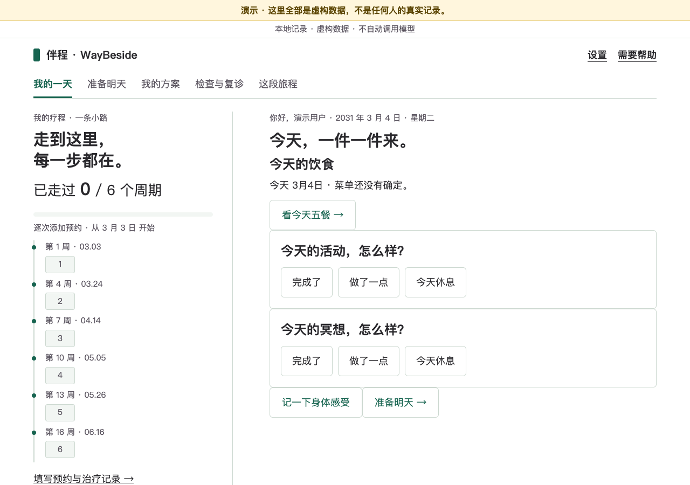
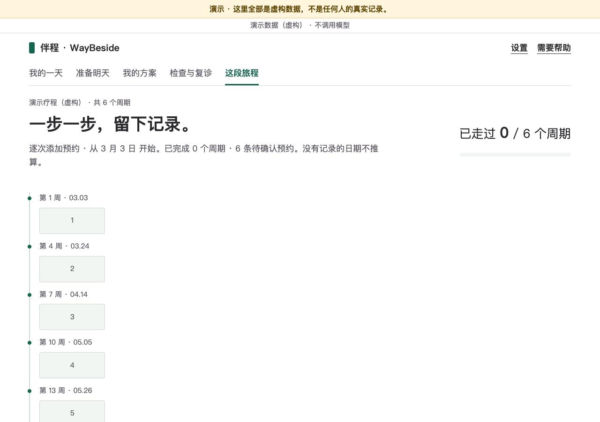

# 伴程 · WayBeside

> 这段路，一天一天走。 · *Walk the course, one day at a time.*

> **重要 / Important：** 伴程是个人记录与规划工具，**不是医疗建议，不是医疗器械，不替代医生、护士、营养师的意见。** 完整声明见 [DISCLAIMER.md](DISCLAIMER.md)。



## 这是什么

一个**只在你自己电脑上运行**的小工具，帮你记录一段治疗疗程里的每一天：按疗程排出“小路”、每天的活动与身体感受、导入自己的菜单、自己填检验结果并看变化。不诊断、不给用药建议，不内置任何医学或营养规则，不联网上传，没有账号。

它是给 **AI 助手**装、给人用的：AI 助手负责下载、安装、帮你记录；你在网页上看、改、决定。

## 给装它的人：三步

需要 Python 3.11。最省事的办法是把本页交给你的 AI 助手，让它照着 [AGENTS.md](AGENTS.md) 装好并启动，再把网页交给你。想自己装：

```sh
python3.11 -m venv .venv
.venv/bin/pip install -r requirements.txt
.venv/bin/python run.py          # 加 --demo 先看虚构的演示数据，不碰真实数据
```

Windows（**未在 Windows 实机验证**）：安装 Python 3.11 后双击 `packaging\setup.cmd`，再双击 `packaging\start.cmd`。关闭服务点页面底部“退出”；端口被占用时加 `--port 8766`。

## 第一次打开网页，会让你选一件事

先看一页免责声明，再选“你希望 AI 助手帮你做多少”。**两项都不预选，不选不能继续**，以后随时可以在“设置 → AI 助手”里换。

**让助手帮我全部打理**

- 助手能看到：你在这里的所有记录，包括检验结果、身体感受、过敏和备注
- 助手能替你做：记录每天的情况、录入检验结果、定好明天的菜单、标记哪次治疗做完了
- 你自己要做：偶尔来看看。助手录的每一条都会标上「助手记录」

**我自己记，助手只帮挑菜单**

- 助手能看到：只有你勾选允许的内容。选这种方式时，检验结果、身体感受和备注助手看不到；以后如果改成第一种，之前记下的这些也会让它看到
- 助手能替你做：从你的菜单里挑出明天吃什么，等你点头
- 你自己要做：每天的情况和检验结果由你或家人在这里记；助手挑的菜单要你点「采用」才算数

拿不准就先选第二种。以后放宽很容易，但助手已经看过的内容收不回来。助手看到的内容会不会传给它背后的 AI 服务，取决于帮你装它的人怎么设置。



## 日常怎么用

1. 首次设置：选好方式后有四步问卷（关于你 / 治疗方案 / 饮食要求 / 日常习惯，可整步跳过，也可以交给助手填），之后都能在“设置”里改。
2. “这段旅程”：每次治疗由你或助手确认完成、改期或取消。
3. “我的方案 / 准备明天”：导入菜单文件（格式见 `examples/menu/`，可用 `tools/verify_menu.py` 检查），再挑选采用。
4. “检查与复诊”：填检验结果、看曲线、记下复诊要问的问题。

规则筛选读取数据目录里的 `rules/*.json`，只做你定义的标签匹配；`examples/rules/` 里是**虚构示例**，不是推荐。请不要把医学规则提交进本项目。

## 隐私与免责

资料只保存在本机数据目录，服务只监听 `127.0.0.1`，无遥测；备份和导出文件**没有加密**，请自己保管。两种方式下助手各能看到什么、记录能证明什么，详见 [PRIVACY.md](PRIVACY.md)；免责声明见 [DISCLAIMER.md](DISCLAIMER.md)。

## 开发与测试

```sh
.venv/bin/pip install -r requirements-dev.txt
.venv/bin/python -m pytest -q
tools/check_hardcodes.sh                       # 必须 0 命中
npm ci && npx playwright install chromium && node tests/browser-private-ui.cjs
```

更多见 [tests/README.md](tests/README.md) 与 [CONTRIBUTING.md](CONTRIBUTING.md)。界面目前仅有中文，文案在 `waybeside/i18n/zh-CN.json`。许可证：Apache-2.0（[LICENSE](LICENSE) · [NOTICE](NOTICE)）。

---

## English summary

**WayBeside (伴程)** is a local-first journal for a course of treatment (e.g. radiotherapy or chemotherapy): a configurable course "trail", daily check-ins, a user-imported meal plan, and self-entered lab trends. It is installed and operated by an AI assistant on behalf of a person; the person uses the web page.

- **Not medical advice, not a medical device.** See [DISCLAIMER.md](DISCLAIMER.md).
- **Mechanism only.** No built-in medical, nutrition or allergy rules, menus or lab reference ranges.
- **Local and private.** Data stays in a local directory, the server binds to `127.0.0.1`, no telemetry. Backups and exports are unencrypted ([PRIVACY.md](PRIVACY.md)).
- **The first page asks the person how much the assistant may do:** everything (the assistant reads and writes all records, each marked "assistant record" in the page), or menu picking only (the assistant sees only what is shared and can only propose menus). Neither is preselected. Assistant instructions: [AGENTS.md](AGENTS.md).
- **Quick start (Python 3.11):** `python3.11 -m venv .venv && .venv/bin/pip install -r requirements.txt && .venv/bin/python run.py --demo`. Windows scripts are in `packaging/` and are **not verified on a real Windows machine**.
- Apache-2.0.
